<div align="center">

<br/>

<p>
  <a href="https://github.com/yashwaje712"></a>
  <a href="https://github.com/yashwaje712?tab=repositories"></a>
  
</p>
`\[ SYSTEM ONLINE ]` · AI / ML learner · Python developer · Product builder
</div>
---
`01 // ABOUT`
Hey, I'm Yash Waje — an AI & Machine Learning student who likes turning ideas into useful software.
I explore the space where data, intelligent systems, and product engineering meet. My projects range from machine-learning dashboards and resume analysis to full-stack applications.
🧠 Exploring Machine Learning, Deep Learning, Computer Vision, and Generative AI
🐍 Building with Python, data workflows, and ML libraries
🧩 Learning to connect intelligent backends with useful user experiences
🚀 Interested in practical projects, clean architecture, and continuous improvement
🎯 Current mission: build projects that are understandable, demonstrable, and genuinely useful
> \*\*Build with intent. Explain the trade-offs. Keep improving.\*\*
---
`02 // FEATURED BUILDS`
<table>
<tr>
<td width="50%" valign="top">
🟢 CIVORA-AI
Citizen Assistance Intelligence API + web app
A full-stack project with a Next.js frontend and FastAPI backend. The backend is organized around authentication, citizen assistance, demand records, verification, and profile APIs.
`Next.js` `React` `TypeScript` `FastAPI` `SQLAlchemy`
Open repository →
</td>
<td width="50%" valign="top">
🟢 HireSense AI
Resume-to-job-description analysis
Analyzes resume text against a target role using TF-IDF and cosine similarity, with skill matching, gap analysis, keyword insights, recommendations, and PDF reporting.
`Python` `Streamlit` `Scikit-learn` `NLP` `PyMuPDF`
Open repository →
</td>
</tr>
<tr>
<td width="50%" valign="top">
🟢 Smart Student Performance Predictor
Machine-learning dashboard for academic performance estimation
Uses a Random Forest regression workflow and a Streamlit dashboard to explore predictions, model metrics, and feature importance. Its repository describes the dataset as synthetic and the project as educational.
`Python` `Pandas` `Scikit-learn` `Streamlit`
Open repository →
</td>
<td width="50%" valign="top">
🟢 EVENTORA — Event Management
A modern event-management product concept
A responsive event platform foundation focused on event discovery and organizer experiences, with further backend and business modules listed in its roadmap.
`React` `TypeScript` `Node.js` `Express` `MongoDB planned`
Open repository →
</td>
</tr>
</table>
---
`03 // TECH ARSENAL`
<p align="center">
  
</p>
<p align="center">
  
  
  
  
</p>
<details>
<summary><b>Current learning map</b></summary>
Area	Focus
AI / ML	Model workflows, evaluation, practical applications
NLP	Text similarity, skill extraction, resume analysis
Backend	FastAPI, API design, data models
Frontend	React, Next.js, TypeScript
Engineering	Git, documentation, project structure, testing
</details>
---
`04 // GITHUB TELEMETRY`
<div align="center">



</div>
<div align="center">

</div>
---
`05 // HOW I BUILD`
```text
\[ DISCOVER ] -> \[ DESIGN ] -> \[ BUILD ] -> \[ TEST ] -> \[ ITERATE ]
       ^                                                  |
       |\_\_\_\_\_\_\_\_\_\_\_\_\_\_\_\_\_\_\_\_\_\_\_\_\_\_\_\_\_\_\_\_\_\_\_\_\_\_\_\_\_\_\_\_\_\_\_\_\_\_|
```
I value projects that communicate three things clearly:
The problem: what need does this solve?
The implementation: how does the system work?
The evidence: how can someone run it, inspect it, and understand its limits?
---
`06 // CONNECT`
<div align="center">
<a href="https://github.com/yashwaje712"></a>
<a href="https://github.com/yashwaje712?tab=repositories"></a>
<br/><br/>
`END OF TRANSMISSION // KEEP BUILDING`

</div>
